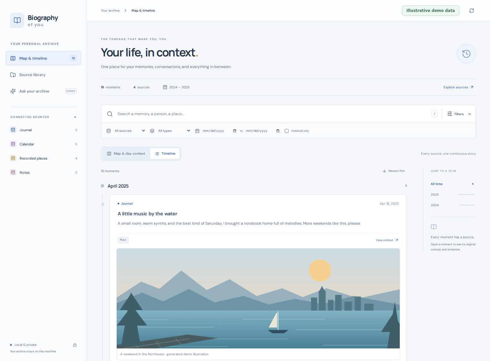
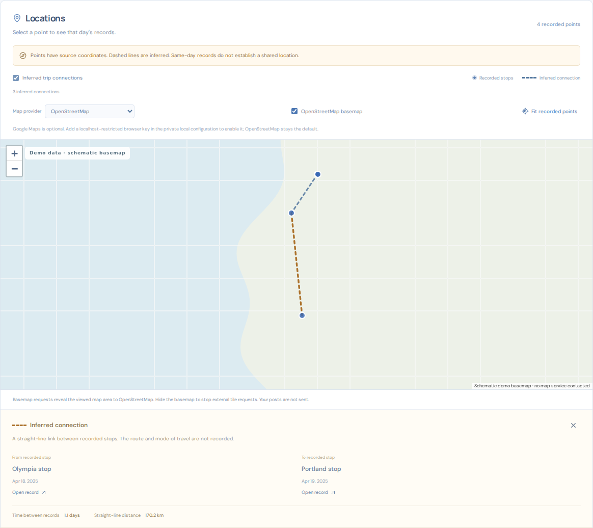
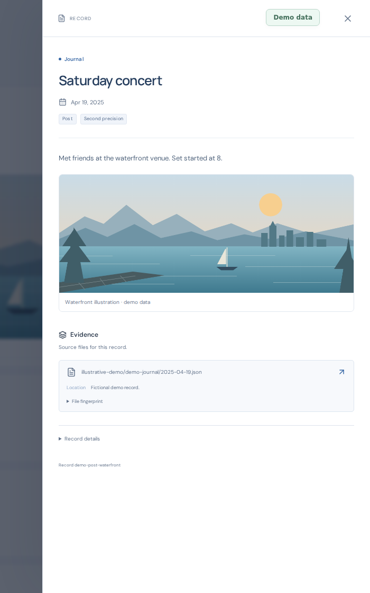

# You Can See Everything

A local archive for personal data exports. Search records, browse days and trips, view attached media, and open the original files.

Python, SQLite and React. Runs on localhost for one user. Personal data stays outside the public repository.

## Run

Requires Python 3.11+, Node.js 20+, `uv`, and Linux or WSL.

```sh
uv sync --extra dev
cd web
npm ci
npm run build
cd ..
cp profile.example.json /path/to/private/profile.json
# Set the export and storage paths in that file.
export BIOGRAPHY_PROFILE=/path/to/private/profile.json
uv run biography init
uv run biography serve
```

Open <http://localhost:8000>.

## Import

Put exports in service folders under the profile's `export_root`.

```sh
uv run biography plan
uv run biography import --source "Example Service"
uv run biography daily-build
uv run biography media-build
uv run biography counts-build
```

Original files are retained by content hash. Identical bytes share one copy. Records keep links to their sources. Unsupported files remain available for later extraction.

Application attachments such as APKs and JARs are retained whole. Their bundled
resources are not expanded into personal records. Ordinary nested export archives
are still processed.

Day indexing and media discovery resume where they stopped. Repeat `daily-build` and `media-build` to continue, or after more imports.

Location indexing runs in small batches during import and saves its progress between batches.

Large files also commit records in small batches so background workers can share
the catalog. A temporary writer lock is retried before ingestion pauses. Rerunning
the import reuses retained files and deduplicates committed records; unfinished
files remain pending until extraction completes.

Existing catalogs need an initial count with `counts-build`; repeat it until complete. Later inserts, edits and deletions update totals automatically. While counting, the app labels the known subtotal instead of guessing the total.

`--move` deletes export copies only after verified retention. Use it on export folders. Active notes, repositories and application histories should be snapshotted first.

## Browse

- **Records:** search and filter imported entries; view media and source files.
- **Days:** group entries by day, summarize measurement samples, and expand the underlying records.
- **Map and Trips:** browse recorded locations, inferred connections and cited trip summaries. Records from the same dates are shown as context; they may be unrelated to the trip.
- **Imports:** view progress, extraction status, observed dates and gaps.
- **Ask:** ask questions, generate day or month summaries, and browse saved summaries. Opening a saved result does not run a model.

Records load before archive totals finish counting. Cached counts are labeled. Days may cover only part of the archive while the day index is building.

Browse views have saved sort preferences. Trips sort by date, inferred straight-line distance, elapsed duration or stops. Sorting applies before pagination; import and assistant history ordering does not change the execution queue.

Google Maps is the default when a key is configured. Otherwise the map uses OpenStreetMap. Either can be selected manually. See [Google Maps setup](docs/google-maps-setup.md).

AI features use the Codex CLI's existing ChatGPT sign-in. Selected source excerpts are sent to that model. Dashboard edits are tested before activation and support undo. These features also require Bubblewrap and Playwright Chromium.

## Storage and backups

Keep personal data and configuration outside this repository. Metadata snapshots exclude original media. See [backup and restore](docs/backups.md) and [private Git LFS packages](docs/lfs-backups.md).

## Screenshots

Fictional records and generated artwork only. The map background is a schematic.



<details>
<summary>Map and source details</summary>




</details>

## Check changes

```sh
uv run pytest
cd web && npm test && npm run build && cd ..
uv run playwright install chromium
uv run python scripts/check_dashboard.py --dist web/dist --fixture --output .local/checks
```

Regenerate the fictional screenshots with `uv run python scripts/generate_demo_screenshots.py` after building the frontend.

MIT license. Use synthetic data in tests, examples and public screenshots.
